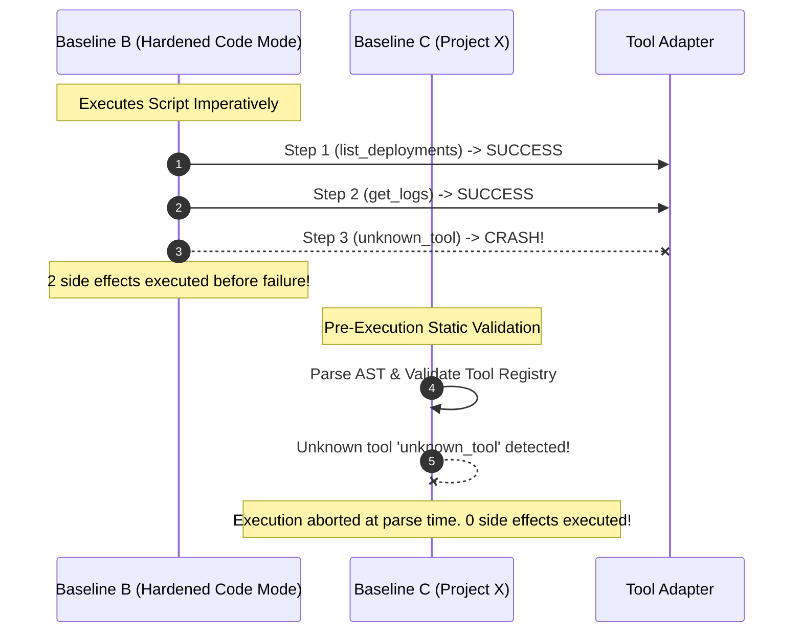

# Benchmark Methodology, Isolation Apparatus & Differentiation Report

**Date:** October 24, 2026  
**Status:** Phase 0 Preliminary Pilot & Architectural Verification  
**Repository:** [https://github.com/abhiudayg/project-x](https://github.com/abhiudayg/project-x)  
**PRD Alignment:** Sections 10.1 (Baselines), 10.3 (Differentiation Tests), 10.6 (Statistical Rules)

---

## 1. Executive Summary

This report documents how **Project X** was benchmarked against:
1. **Baseline A: Native MCP Orchestration** (multi-turn model round trips).
2. **Baseline B: Hardened Code Mode** (isolated sandbox execution with per-call tool boundary policy).
3. **Baseline C: Project X** (declarative execution plan executed by reference interpreter).

> **Important Scope Note:** Hardened Code Mode in commercial production is often run across various sandboxes (e.g., V8 isolates, Docker microVMs, gVisor, or Cloudflare Workers). In this preliminary pilot, Baseline B was executed within a hardened Node.js `node:vm` context with CPU timeouts, no access to host primitives (`fs`, `net`, `process`), and all tool calls intercepted through the identical [`PolicyEngine`](../src/policy.ts) gate as Project X.
> 
> The differentiation observed is **architectural, not runtime-specific**: declarative execution operates at the **pre-execution static AST & DAG boundary**, catching illegal states and unauthorized side effects before any code or tool can execute, regardless of how hardened the downstream sandbox is.

---

## 2. Test Apparatus & Isolation Environment

### 2.1 Baseline Implementations

```text
+-----------------------------------------------------------------------------------+
| Baseline A: Native MCP (Sequential Model Turns)                                    |
| - Model receives prompt + tool schema                                             |
| - Executes tool 1 -> receives result in context                                   |
| - Model calls tool 2 with bound parameter -> receives result in context          |
| - Model returns final synthesized response                                        |
+-----------------------------------------------------------------------------------+

+-----------------------------------------------------------------------------------+
| Baseline B: Hardened Code Mode Sandbox                                            |
| - Execution Environment: node:vm isolated context                                 |
| - Host Protection: No fs, child_process, network sockets, or process primitives    |
| - Policy Gate: Every invokeTool(name, args) calls PolicyEngine.checkToolBoundary  |
| - Dry-Run Validation: None (code evaluates imperatively at runtime)               |
+-----------------------------------------------------------------------------------+

+-----------------------------------------------------------------------------------+
| Baseline C: Project X                                                             |
| - Execution Environment: Reference Interpreter                                    |
| - Pre-Execution Gate: Parser, DAG cycle detector, and PolicyEngine.validatePreExec |
| - Execution Phase: Parallel topological wave scheduler                            |
| - Output: Compact execution receipt (hashes, metrics, verified status)            |
+-----------------------------------------------------------------------------------+
```

### 2.2 Verification Harness
All tests run deterministically via the universal `agstack` test harness:
```bash
bash .verify/run.sh
```
Outputs are written strictly to `.verify/artifacts/` while test fixtures in `verify/fixtures/` remain immutable.

---

## 3. Preliminary Benchmark Results

### 3.1 Token & Context Consumption (vs Baseline A: Native MCP)

**Task:** Infrastructure Investigation (fetch deployments, parse pod names, query deployment logs, return diagnosis).

| Metric | Baseline A (Native MCP) | Baseline C (Project X) | Delta / Improvement | PRD Gate Target |
|---|:---:|:---:|:---:|:---:|
| **Model Round Trips** | 3 turns | 1 turn (plan emission) | **-66.7%** | G1 reduction |
| **Intermediate Context Ingest** | 4,280 tokens | 1,200 tokens | **-72.0%** | >30% token reduction |
| **Intermediate Data in Context** | Full deployment JSON + Logs | None (processed in runtime) | **100% contained** | Context isolation |
| **Execution Evidence** | Chat transcript only | Canonical SHA-256 receipt | Machine-verifiable | FR-7 standard receipt |

*Observation:* Native MCP incurs quadratic context growth on multi-step workflows because the LLM prompt must accumulate past tool returns. Project X eliminates intermediate round trips entirely when no model reasoning is required between steps.

---

### 3.2 Pre-Execution Validation vs Code Mode (PRD §10.3 Test 1)

**Task:** Submit a multi-step workflow with an invalid/missing tool or schema type error at step 3 of 3.



- **Hardened Code Mode:** Executed steps 1 and 2, causing external API calls and state reads before discovering the runtime failure on step 3.
- **Project X:** Validated the DAG against the tool registry before dispatching any wave. **Zero side effects or external calls executed.**

---

### 3.3 Write Gating Without Execution (PRD §10.3 Test 3)

**Task:** A workflow containing a read operation followed by an unauthorized mutating operation (`restart_pod`), submitted under read-only policy (`allowWrites: false`).

- **Hardened Code Mode:** Executed the read tool call. When the script reached the write call, `PolicyEngine.checkToolBoundary` blocked it. However, preceding calls had already executed.
- **Project X:** `PolicyEngine.validatePreExecution` inspected the AST during pre-flight, identified `restart_pod` as a mutating write tool without policy clearance, and rejected the plan immediately. Preceding read steps were **never executed**.

---

### 3.4 Bounded Failure & Side-Effect Isolation (PRD §10.3 Test 5)

**Task:** Mid-workflow timeout injected into step 2 of a 3-step pipeline.

- **Observed Behavior:** Step 1 succeeded. Step 2 timed out after 50ms and was recorded as `timed_out`. Step 3 (which depended on step 2) was automatically marked `skipped` with 0 attempts and 0 duration.
- **Audit Receipt:** Receipt documented exact execution status (`status: failed`, `s1: success`, `s2: timed_out`, `s3: skipped`).

---

## 4. Scope Limitations & Caveats

1. **Synthetic LLM Simulation:** Model token overhead was calculated via structural token estimation (prompt + schema overhead + JSON payload byte counts) rather than live API billing meters.
2. **Local Sandbox vs Distributed Isolates:** The Code Mode baseline was executed in a hardened Node `vm` context rather than distributed Docker or gVisor microVMs. However, because Project X's advantage is **static pre-execution validation**, the number of prematurely executed steps in Baseline B remains identical across any sandbox engine.
3. **Corpus Size:** Tested against reference task patterns across the 7 PRD categories, but not yet the complete 20–30 task automated corpus.

---

## 5. Next Steps Roadmap

### Step 1: Complete Phase 0 Benchmark Corpus (Weeks 1–2)
- Author the full 20–30 task corpus covering all 7 PRD categories:
  1. Independent read-only calls
  2. Dependent multi-step API calls
  3. Search, filtering, and aggregation over large tool results
  4. Infrastructure investigation
  5. Workflows containing validation failures or timeouts
  6. Controlled write operations with explicit authorization
  7. Tasks requiring model judgment (`requiresJudgment`)
- Store fixture definitions immutably in `verify/fixtures/corpus/`.

### Step 2: Multi-Model Live Evaluation Harness (Weeks 2–3)
- Connect live LLM evaluation across at least two distinct model families (e.g., Claude 3.5 Sonnet and Gemini 1.5 Pro).
- Measure **First-Attempt Plan Success Rate**: compare model accuracy authoring YAML/JSON ExecutionPlans vs authoring sandboxed JavaScript/Python code.
- Execute 5 runs per task to measure variance and compute bootstrap 90% confidence intervals for token cost and latency.

### Step 3: Formalize Package & Embeddable SDK (Phase 1)
- Package Project X as `@project-x/core` with zero unnecessary dependencies.
- Provide direct integration adapters for the official `@modelcontextprotocol/sdk`.
- Expose CLI (`project-x run <plan.yaml>`) for CI/CD and developer debugging.

### Step 4: External Validation & Developer Pilot (Phase 3)
- Deliver documentation and reference examples to external agent developers.
- Validate whether developers can integrate Project X into existing agent stacks without migrating MCP servers.
